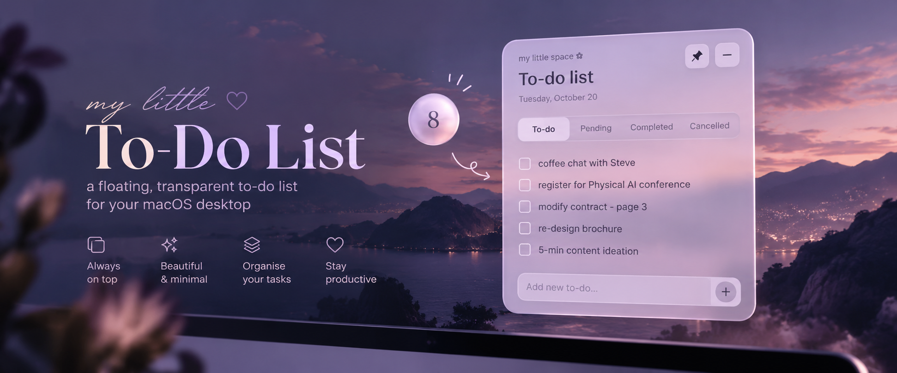
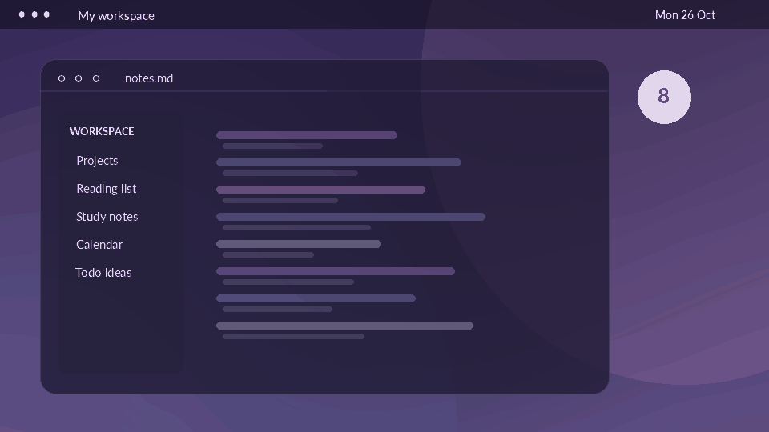

<div align="center">

  

  <br />

  # ✿ My Little To-Do List

  **A tiny, floating to-do list that stays where you work.**

  A minimal, translucent desktop task manager built with Electron, HTML, CSS and JavaScript — designed with macOS in mind.

  <br />

  
  
  
  

</div>

---

## ✨ Why this project?

Checking your tasks shouldn't become another task. **My Little To-Do List** lives on your desktop as a small bubble, expanding into a translucent panel whenever you need it — without switching to a separate productivity app.

## 🎬 Preview

<div align="center">
  
  <br />
  <sub>Illustrative UI concept, not a screen recording of the running application. A real app demo will replace it after testing.</sub>
</div>

## 🌷 Features

- **Floating task counter:** a compact bubble displays the number of tasks still open.
- **Expand & collapse:** click the bubble to reveal the full task list, then minimize it again.
- **Translucent interface:** a soft glass-inspired look with rounded corners and lavender tones.
- **Focus-aware appearance:** the panel becomes more transparent when another app is active.
- **Always-on-top option:** pin the widget over other windows or unpin it.
- **Four task states:** `To-do`, `Pending`, `Completed` and `Cancelled`.
- **Task management:** add, complete, restore, move, cancel and delete tasks.
- **Local persistence:** tasks are saved on your computer using `localStorage`; no account or database required.

> [!NOTE]
> This is an **early prototype**. Native macOS transparency/blur effects and behaviour across full-screen Spaces may vary; the GIF above illustrates the intended experience.

## 🚀 Getting started

### Requirements

- [Node.js](https://nodejs.org/) (a current LTS version, including npm)
- macOS for the intended desktop experience

### Run locally

```bash
# 1. Clone this repository
git clone https://github.com/eduardagomes12/To-Do-List.git

# 2. Open the project folder
cd To-Do-List

# 3. Install the dependencies
npm install

# 4. Launch the desktop app
npm start
```

The app initially opens as a small bubble. Click it to view your tasks. On macOS, quit the app with **⌘ Q**.

## 🗂️ Project structure

```text
To-Do-List/
├── assets/
│   ├── cover.png       # README cover artwork
│   └── demo.gif        # Illustrative animated preview
├── index.html          # Widget markup
├── main.js             # Electron window and macOS behaviour
├── preload.js          # Secure bridge to the Electron API
├── renderer.js         # Task logic, events and local storage
├── styles.css          # Glass-inspired styling and animations
├── package.json        # Scripts and dependencies
├── package-lock.json   # Dependency lockfile (generated by npm)
├── .gitignore
└── README.md
```

## 🎨 Make it yours

The visual theme can be changed in `styles.css`:

```css
:root {
  --accent: #b5a3c9;
  --accent-dark: #8e7aa8;
  --glass-focused: rgba(249, 246, 252, 0.84);
  --glass-unfocused: rgba(249, 246, 252, 0.49);
}
```

- Change **colors and opacity** in `styles.css`.
- Change **layout and labels** in `index.html`.
- Change **task behaviour** in `renderer.js`.
- Change **window size and positioning** in `main.js`.

## 🛠️ Built with

**Electron** · **HTML5** · **CSS3** · **Vanilla JavaScript** · **localStorage**

## 📝 Roadmap

- [ ] Test and fine-tune the visual effects on macOS
- [ ] Add task categories (study, work, personal)
- [ ] Add drag-and-drop task ordering
- [ ] Add optional keyboard shortcuts
- [ ] Package a downloadable macOS `.dmg` release
- [ ] Replace the illustrative GIF with a real screen recording

## 👩🏻‍💻 Author

Created by **[Eduarda Gomes](https://github.com/eduardagomes12)**.

<div align="center">
  <sub>Made with ♡ to make everyday planning feel a little lighter.</sub>
</div>
